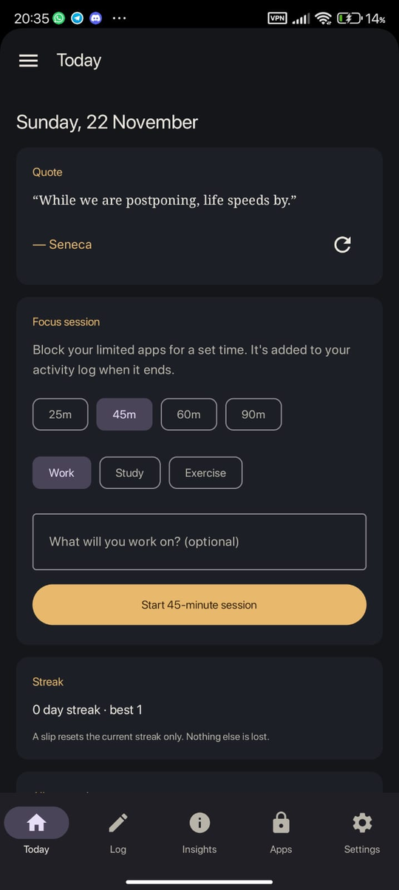
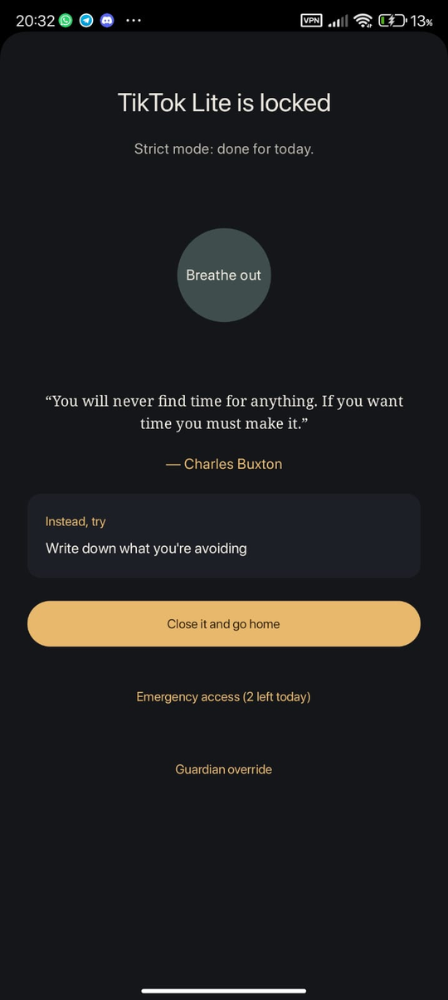
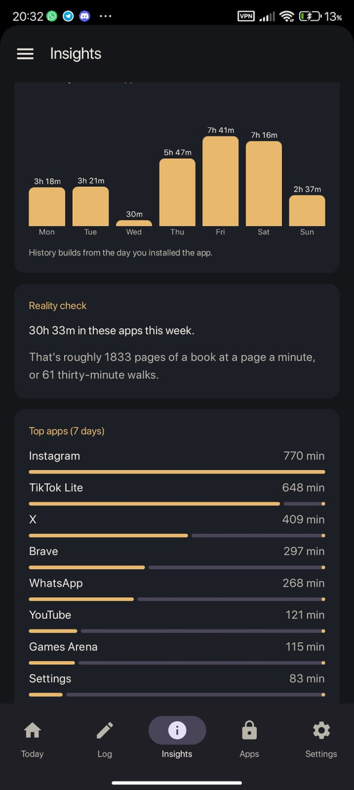
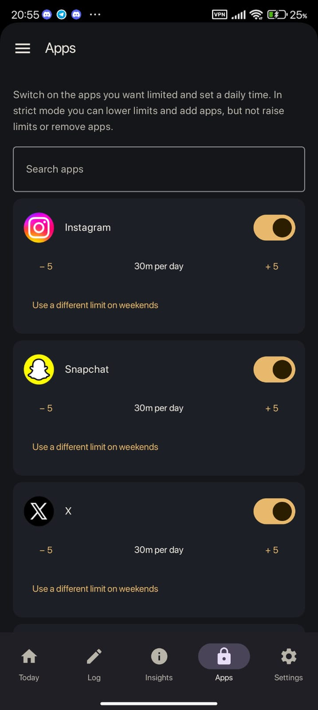
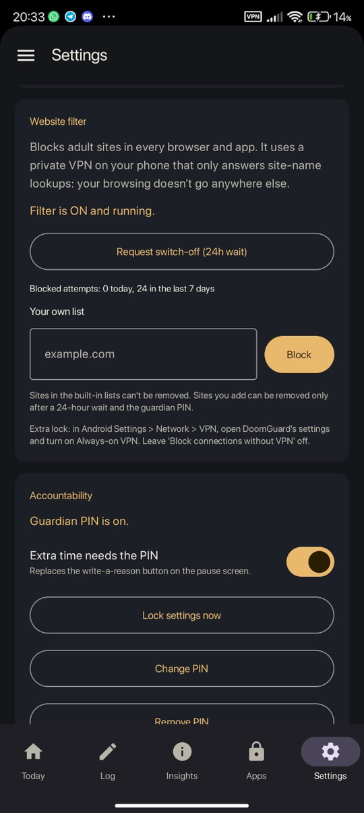
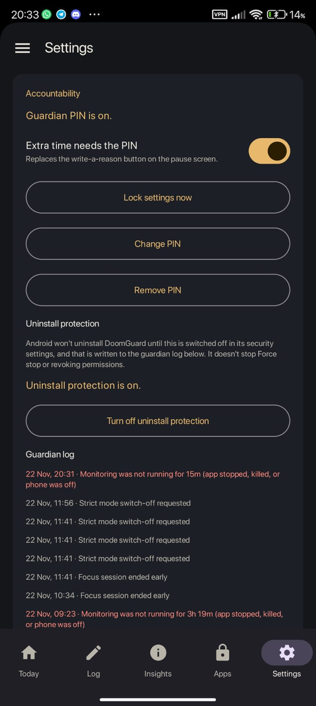

# DoomGuard

An Android app that stops doom scrolling. You pick the apps that drain you and set a daily time for each.
When time is up, DoomGuard covers the app with a pause screen (breathing circle, a quote, a better idea) and makes
carrying on deliberately hard. It also tracks where your time goes, blocks adult sites system-wide,
and adds accountability so the rules can't be quietly loosened in a weak moment.

Built as a personal project: Kotlin and Jetpack Compose (Material 3), no servers, no accounts, no analytics. All data stays on the phone.

## Screenshots

| Today | Pause screen | Insights |
|---|---|---|
|  |  |  |

| Apps and limits | Website filter | Guardian log |
|---|---|---|
|  |  |  |

## Highlights

- **A pause, not just a block**: escalating waits, written reasons, mood tracking, and a lock after too many extensions
- **Real usage data**: per-screen tracking of foreground time from Android's usage events, with a 7-day history and trigger patterns
- **System-wide website filter**: a local DNS-only VPN with ~83,000 bundled domains, no remote server
- **Accountability that holds**: salted-hash guardian PIN, 24-hour cool-downs, tamper log, uninstall protection
- **Built to survive Android**: watchdog alarm, boot and update handling, and notes on OEM battery killers
- **Everyday touches**: Quick Settings tile, home-screen widget, weekly auto-backup, 99 quotes

## Tech notes

- Single-module Android app: Kotlin 2.0, Compose BOM 2024.12, Material 3, minSdk 26, targetSdk 34
- Storage is JSON in SharedPreferences (no Room), with a version counter that drives Compose recomposition
- Foreground service polls `UsageStatsManager.queryEvents` incrementally; the pause screen is launched using the overlay permission
- The website filter is a `VpnService` that routes only a fake DNS address, answers blocked names with NXDOMAIN and forwards the rest through a protected socket
- CI builds a debug APK on every push (`.github/workflows/build.yml`)

## Run it

1. Install Android Studio (Ladybug or newer) and open this folder (`DoomGuard/`). Download a ready-made debug APK from the latest GitHub Actions run if you only want to try it.
2. Let Gradle sync. Android Studio will download the SDK pieces and create the Gradle wrapper itself.
3. Plug in your phone (USB debugging on) or use an emulator, then press Run.

## First-run setup on the phone

The app can't work without these. The Today tab shows a "Finish setup" card until they're done.

| Permission | Why |
|---|---|
| Usage access | Lets DoomGuard see which app is open and for how long |
| Display over other apps | Lets the pause screen appear on top of the app you're scrolling |
| Notifications | Quote reminders, limit warnings, evening review |
| Battery: unrestricted | Stops the phone killing the background monitor |

Tecno, Infinix, Xiaomi, Oppo, Vivo and Samsung phones are aggressive about killing background apps.
If blocking stops working after a while, set DoomGuard to "unrestricted" or "auto-start" in system
App info > Battery, and lock it in the recent-apps list.

## What's inside

- **Today**: quote, focus-session timer, streak, time used vs limit per app, **all apps used today with time spent (limited or not, with a one-tap Limit button)**, phone pickups (unlocks and time of first unlock), today's intentions (to-do), evening review
- **Log**: log activities (text, category, minutes), search, grouped by day, CSV export
- **Insights**: 7-day usage chart, top apps over 7 days, "reality check" conversion, 7-day phone pickups, trigger patterns (feeling, why you opened an app, time of day), logged time by category, shareable weekly summary
- **Apps**: choose which apps to limit and set limits in 5-minute steps
- **Settings**: permissions, light/dark/match-phone appearance, open-app pause, strict mode, quote interval, focus hours, evening reminder, **accountability (guardian PIN and log)**, backup and restore, CSV export
- **Quotes side panel** (swipe from the left edge or tap the menu icon): current quote, themes, favourites, hide, add your own. Rotates on your chosen interval and also arrives as a notification.

## How blocking works

0. **Open-app pause**: opening a limited app first shows "What are you here for?" with a short wait (8 seconds by default). Answer, then the app opens and isn't questioned again for 10 minutes. The answers feed the Insights tab. Turn it off in Settings.
1. At 80% of the limit: a notification with the time left.
2. At 100%: full-screen pause screen. Close the app, or wait 15 seconds and write a reason (8+ characters) to get 5 more minutes.
3. Second continue: 30 second wait, 5 minutes. Third: 60 second wait, 3 minutes.
4. After that the app is locked for 30 minutes.
5. **Focus hours**: limited apps are blocked outright in the window you choose (default 22:00 to 06:00).
5b. **Focus sessions**: start a 25 to 90 minute session from the Today tab. All limited apps are blocked until it ends, and the session is added to your activity log automatically (or partially, if you end it early).
6. **Strict mode**: no continue button at all, limits can't be raised, apps can't be removed, monitoring can't be paused, focus sessions can't be ended early and backups can't be restored. Switching it off takes 24 hours.

## Accountability (guardian PIN)

Set a PIN in Settings > Accountability, ideally one chosen by someone else (a parent, partner or friend).
With a PIN set:

- Anything that loosens the rules asks for it: raising or removing a limit, pausing enforcement, turning off
  the open-app pause or focus hours, ending a focus session early, requesting strict-mode switch-off, restoring a backup.
- The pause screen swaps the write-a-reason button for a **Guardian override**: the guardian types the PIN and picks
  10 to 60 minutes. (Switch this off in Settings if you still want self-service extensions.)
- Entering the PIN in the app unlocks settings for 5 minutes, and leaving the app locks them again.
- 5 wrong tries lock PIN entry for 15 minutes.
- The **guardian log** records overrides, PIN changes, loosening changes, permissions switched off, and gaps when
  monitoring was not running. Permission loss also posts a notification.
- The PIN is stored only as a salted PBKDF2 hash, and it is never written into backup files.

This is on-device only: whoever holds the phone sees the log and the alerts, and there is no remote parent app.

## Reliability, caps and safety valves

- **Watchdog**: an alarm wakes a receiver about every 15 minutes and restarts the monitor if the phone's battery manager
  killed it. It also restarts after a reboot and after the app is updated. Settings shows "Monitor: running" or when it was last seen.
  Android cancels alarms on a force-stop, so that one case is only recorded in the guardian log.
- **Daily total cap**: one shared limit across all limited apps (Settings > Daily total cap). Raising or removing it counts as loosening
  (strict mode refuses, the guardian PIN is asked).
- **Weekend limits**: any limited app can have a different Saturday and Sunday limit (Apps tab). Late-night blocking is the existing Focus hours.
- **Always allowed**: calling, messaging and maps apps (plus the phone's default dialer and SMS app) can never be limited.
  Use "Always allow this app" in the Apps tab to add your own, e.g. banking or M-Pesa.
- **Emergency exit**: on the pause screen, 10 minutes for a real reason (default 2 per day, 0 to 5 in Settings), after a 10 second wait.
  Works even in strict mode and every use goes in the guardian log.

## Tracking accuracy and tamper resistance

- **Per-screen tracking**: the tracker follows each app's individual screens (activities), so an app only counts as closed when its *last* screen is gone.
  This fixes a hole where opening an app from a notification (especially one that switches accounts and rebuilds the app's main screen) could make
  DoomGuard think the app had left the screen, skipping the pause and not counting the time. The monitor also checks every 2 seconds.
- **Discreet notifications**: the always-on notifications are neutral ("DoomGuard is running") and hidden on the lock screen. The warning about
  Private DNS is only written to the guardian log, with no notification explaining the workaround.
- **Uninstall protection** (Settings > Accountability): registers DoomGuard as a device administrator with no extra powers. Android then refuses to uninstall it
  until protection is switched off in system security settings, which shows a warning and writes to the guardian log. It doesn't stop Force stop or revoking permissions.
- Android requires the monitor's foreground notification, so it can't be removed entirely. It can be hidden from the lock screen and muted in system notification settings.
- **Dual apps / second space**: apps cloned by the phone maker (Xiaomi "Dual apps", Samsung "Dual Messenger", Second space) run as a separate user, and
  Android doesn't let one user's app see another's usage, so those clones can't be limited by DoomGuard.

## Quick access and backups

- **Quick Settings tile**: swipe down, edit the tiles, drag in "Start focus". One tap starts a 25-minute focus session and the tile shows the time left.
  Tapping a running session tries to end it early; strict mode or a locked guardian PIN refuse and open the app instead.
- **Home-screen widget**: long-press the home screen, Widgets, DoomGuard. Shows focus time left, or the limited app closest to its limit
  (and the total cap if you set one). The monitor refreshes it every minute.
- **Automatic backup** (Settings): pick a folder once. Every 7 days a backup file is written there and the last 4 are kept.
  Choose a synced folder (for example in Google Drive, if it shows in the picker) so a lost phone doesn't lose your data.
  The guardian PIN is never written to backups, and restoring one can't change the website filter or the backup folder.

## Website filter (adult sites)

Settings > Website filter. It runs a private VPN on the phone that captures only DNS lookups (the "where is this site?" step).
Blocked names get "no such domain" back; everything else is forwarded to your phone's normal DNS server. Nothing else goes through the tunnel,
so speed and battery are barely affected, and there is no remote server.

- Built-in lists: about 77,000 adult domains (from the open-source StevenBlack/hosts project, MIT licence).
  Matching includes subdomains. They can't be removed from inside the app.
- Your own list: add any site. Removing one needs a 24-hour wait, plus the guardian PIN if one is set.
- Switching the filter off needs a request, the guardian PIN if one is set, and a 24-hour wait (like strict mode). Restoring a backup can't change it.
- Bypass handling: well-known DNS-over-HTTPS providers are blocked so browsers fall back to normal lookups, and Firefox's DoH canary domain is blocked
  so it turns DoH off. If Android's Private DNS is set to a specific server the app warns you, logs it and posts a notification.
- Tamper handling: if the VPN is switched off in system settings or replaced by another VPN, the app logs it, notifies you, and the watchdog tries to restart it.
  Counts of blocked attempts show on Today and in the weekly summary, and the guardian log gets one summary line per 30 minutes.
- Extra lock: in Android Settings > Network > VPN > DoomGuard, turn on Always-on VPN. Do not turn on "Block connections without VPN" (the tunnel carries DNS only, so that would cut off the internet).
- Limits: it can't stop a determined person from turning the VPN off in Android's settings after the wait, using another phone, or an IP address typed directly.
  It only handles UDP DNS over IPv4, and only one VPN can run at a time.
- Needs the INTERNET permission (to forward DNS lookups) and ACCESS_NETWORK_STATE. The app still has no accounts or servers.

## Code map (`app/src/main/java/com/doomguard/app/`)

| File | Role |
|---|---|
| `MonitorService.kt` | Foreground service, polls every 3s, decides when to block, sends quote/evening notifications; also `BootReceiver` |
| `UsageTracker.kt` | Converts Android usage events into per-app foreground time |
| `BlockActivity.kt` | The pause screen |
| `Store.kt` | JSON-in-SharedPreferences storage (activities, limits, triggers, tasks, quotes, history, focus sessions, backup and restore) |
| `Guardian.kt`, `GuardianUi.kt` | PIN hashing, lockout and unlock window; PIN dialogs, gate and the Accountability section |
| `WebFilterService.kt`, `WebFilterUi.kt` | Website filter: DNS-capturing VPN service, domain matching, Settings section |
| `FocusTileService.kt`, `StatusWidget.kt` | Quick Settings tile and home-screen widget |
| `AutoBackup.kt` | Weekly backup to a chosen folder, plus its Settings section |
| `Watchdog.kt` | Alarm-based restart of the monitor service |
| `Essentials.kt` | Apps that can never be limited (dialer, messages, maps, your allow-list) |
| `FocusCard.kt` | Start, watch and end a focus session |
| `Quotes.kt` | 99 built-in quotes (Dostoevsky, the Stoics, Thoreau, Emerson, Tolstoy, Swahili proverbs and more), tagged by theme; the pause screen draws only from the reflection set |
| `MainActivity.kt`, `*Screen.kt`, `QuotePanel.kt`, `Theme.kt` | UI |

## Known limitations

- Quotes are offline only. Adding more means editing `Quotes.kt` or using **+ Add my own quote** in the side panel.
- Usage history in Insights builds from install day (the service records it each minute).
- Phone unlocks come from Android's keyguard events. Phones with no lock screen may show 0.
- A determined person can still uninstall the app or revoke permissions. Strict mode and the guardian PIN raise the bar, but Android doesn't allow an app to protect itself from that. Clearing the app's data removes the PIN, though it also wipes limits and the log.
- Built-in quotes were chosen for confident attribution and mostly come from public-domain translations, but I could not check sources from the build environment. Spot-check any you plan to share publicly.

## Credits

Blocklists in `app/src/main/assets/` are derived from [StevenBlack/hosts](https://github.com/StevenBlack/hosts) (MIT licence), porn-only extensions.
